# Holy Unofficial Addon

An unofficial addon for **Mad Games Tycoon 2**, made to sit alongside **The Holy Expansion**. It adds new systems
on top of the game's own numbers (MMO management, your own digital store and copy protection, timed exclusives,
more kinds of updates, outside contractors) plus quality-of-life tools such as an employee editor, press reviews
with named outlets and faster game speeds.

It's a hobby project for friends: not for sale, and not affiliated with Eggcode Games or with The Holy Expansion's
author.

**Version:** 0.11.8 · **Game:** Mad Games Tycoon 2 (Steam, PC) · **Loader:** BepInEx 5

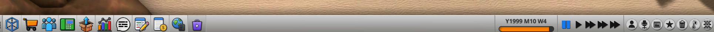

---

## Contents

- [Installing](#installing)
- [Features](#features)
- [Settings](#settings)
- [Compatibility and saves](#compatibility-and-saves)
- [Known issues](#known-issues)
- [Building from source](#building-from-source)
- [Credits](#credits)

---

## Installing

**You need:** Mad Games Tycoon 2 with **BepInEx 5** (tested with 5.4.23). If you already play with The Holy
Expansion, you have BepInEx already.

1. On this page, click **Code > Download ZIP** and unzip it.
2. Open the game folder: in Steam, right-click Mad Games Tycoon 2 > **Manage > Browse local files** (the folder with
   `Mad Games Tycoon 2.exe` in it).
3. Copy the **`BepInEx`** folder from the zip's **`Install`** folder into the game folder, and say yes to merging
   folders. The addon ends up in `BepInEx\plugins\HolyUnofficialAddon`.
4. Start the game. The addon's buttons appear on the bottom bar.

**Updating:** do the same again and let the new files replace the old ones. Your settings and saves are kept.

**Removing:** delete `BepInEx\plugins\HolyUnofficialAddon` (and, if you like, its settings file
`BepInEx\config\holyunofficialaddon.mgt2.cfg`). Back up your saves first: loading a save without the addon hasn't
been tested.

---

## Features

### Bottom bar buttons

Four buttons next to the game's own: the addon's main window, **Contracts**, **MMO Management** and **Your digital
store**. Like Holy's Social Media button, MMO Management and the store stay greyed out until you can use them, and
the tooltip says why.

### The addon's window: employees and game settings

<p>
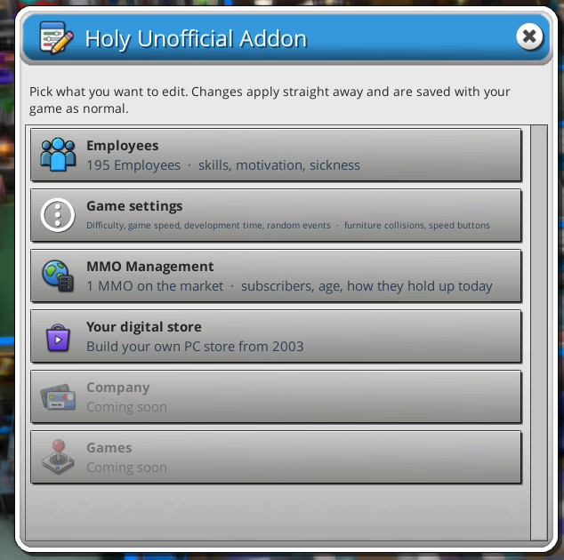
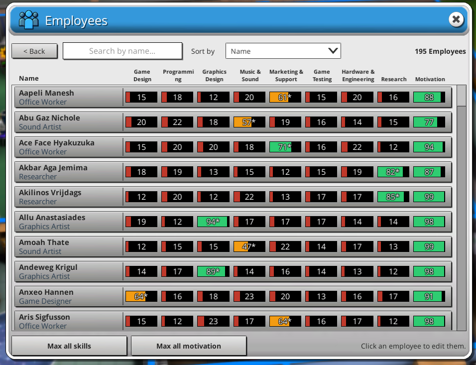
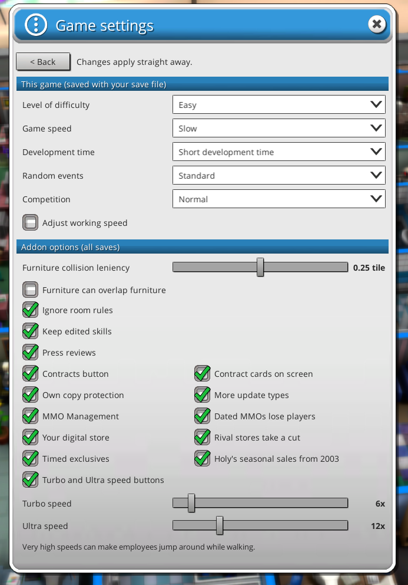
</p>

- **Employees:** every employee's eight skills and motivation at a glance, searchable and sortable. Click someone
  to edit their skills, motivation and sickness, or max everyone at once. Skills you raise outside a profession stay
  where you put them (the game normally pushes them back down to 50).
- **Game settings:** change the new-game settings mid-game (difficulty, game speed, development time, random
  events, competition, working speed), and switch each of the addon's features on or off.

### Faster speeds

**Turbo** (6x) and **Ultra** (12x) buttons next to the game's speed buttons, also on keys **4** and **5**. Both
speeds can be changed in Game settings.

### Building

Optional looser furniture placement: a collision leniency slider (furniture boxes are often bigger than what you
see), furniture overlapping furniture, and any object in any room.

### Press reviews

<p>
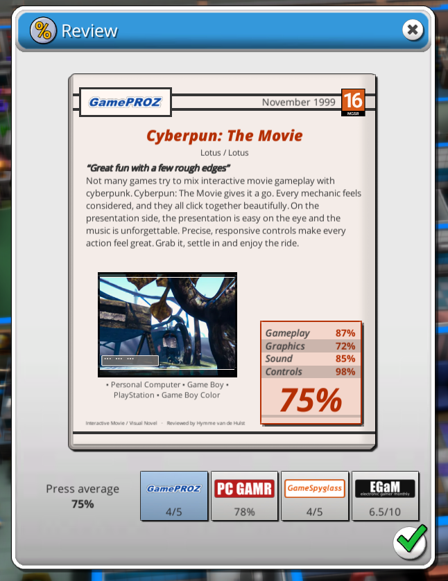
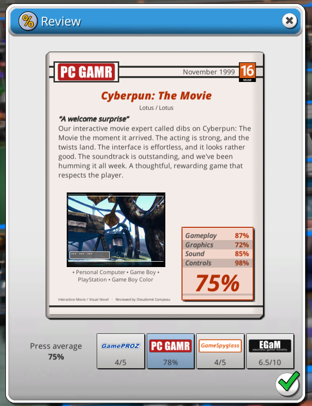
</p>

Your games are reviewed by named outlets (31 parody magazines and sites, each with its own logo and scoring
scale), with reviewers, headlines and text that fit the genre and how the game did. A strip along the bottom shows
every outlet's score; click one to read its review. The game's own scores aren't changed. English game language
only.

### Contracts

<p>
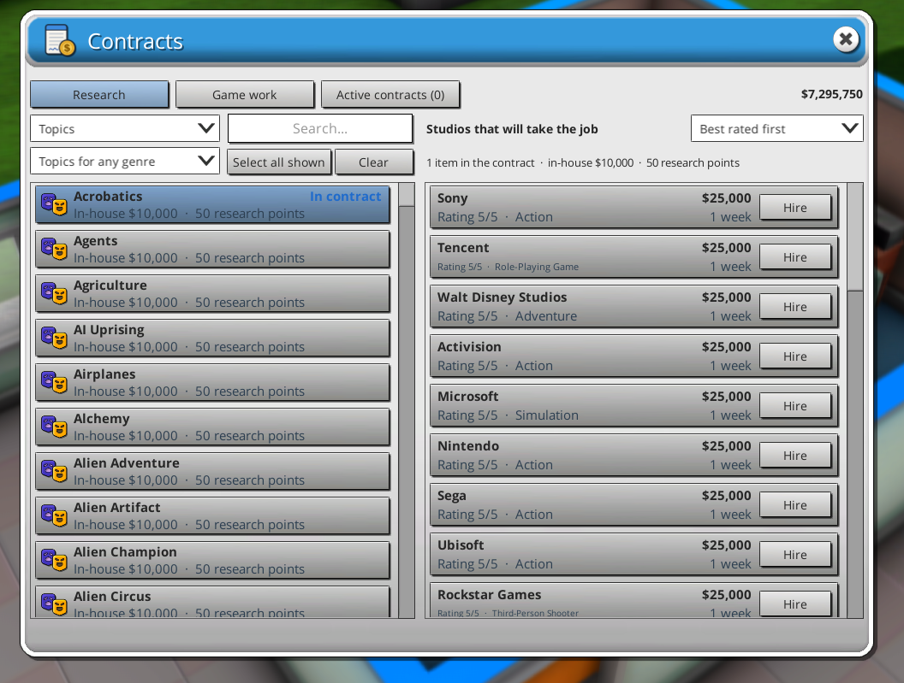
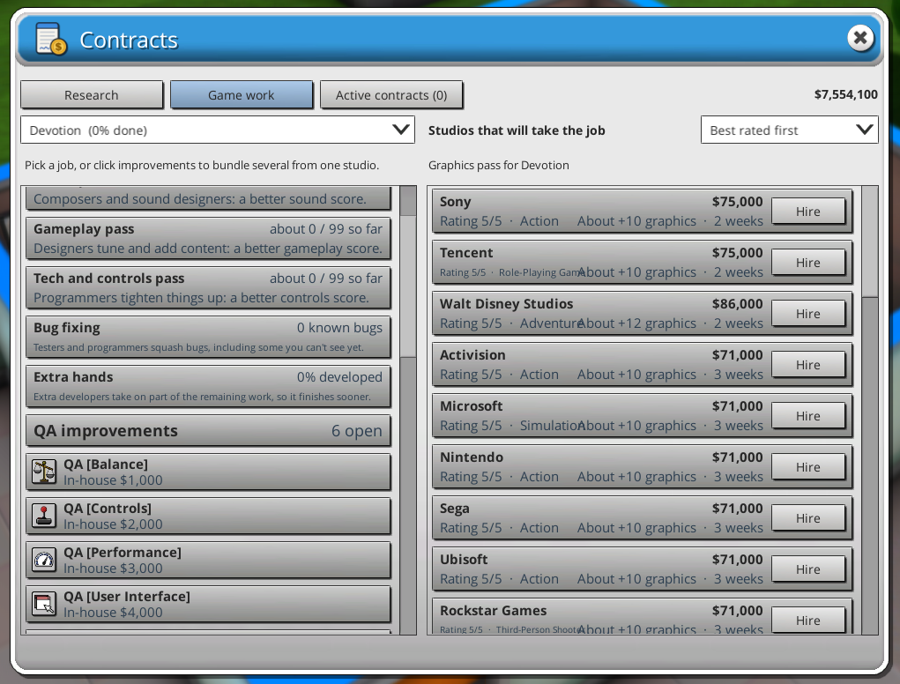
</p>

Hire outside studios instead of doing everything in-house:

- **Research:** bundle any number of topics, genres, gameplay and engine features, hardware and other research
  into one contract. Studios quote a price and a time.

  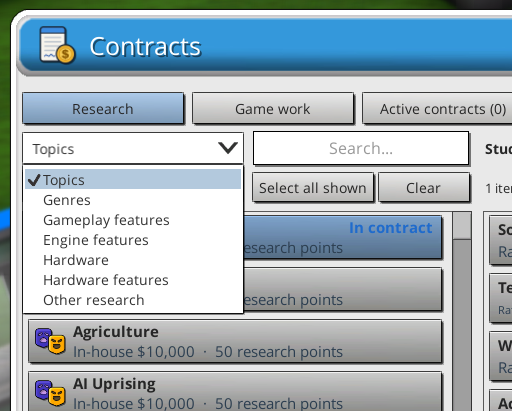
- **Game work** on a game in development: graphics, sound, gameplay and tech passes, bug fixing, extra hands to
  finish sooner, and QA and studio work.
- Running contracts show as small cards on screen that you can drag where you like.

### Your own copy protection

<p>
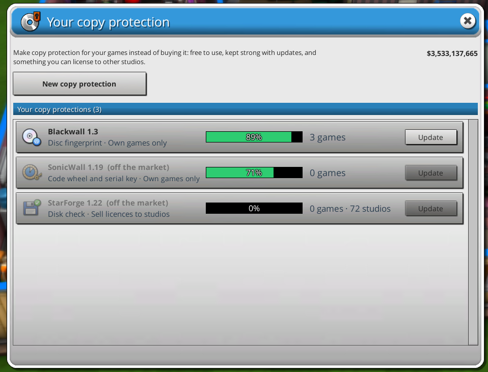
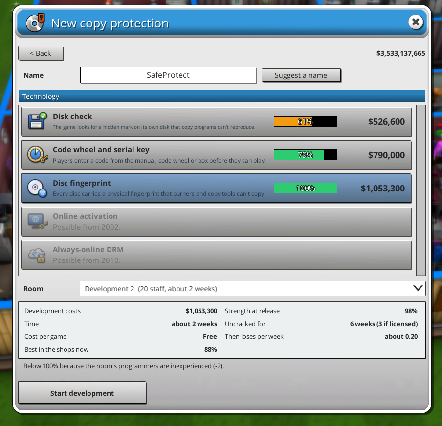
</p>

Research **Copy protection** (Research > Other, from 1980), then develop your own in a development room
(**Develop Copy Protection** in the room menu). Technologies arrive over the years: disk check, code wheel and
serial key, disc fingerprint, online activation (2002) and always-online DRM (2010). It's free to use on your own
games, stays strong while you keep it updated, and you can license it to other studios.

### More kinds of updates

**Updates & Addons** in a development room gets four more update types for your games on the market:

- **Port to more platforms** of the same kind (the game's own port only crosses PC, console, handheld and arcade).
- **Engine update:** bring in newer features from the game's engine.
- **New gameplay features** after release.
- **Age rating change.**

Each one counts as one of the game's updates. With The Holy Expansion, engine, feature and rating updates also cut
pirated copies like a normal update. Addons no longer get blocked when a game has more features than its size
normally allows because you added some after release.

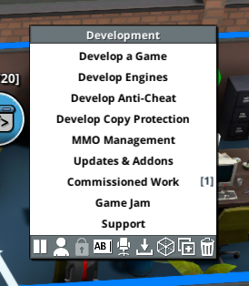

### MMO Management

<p>
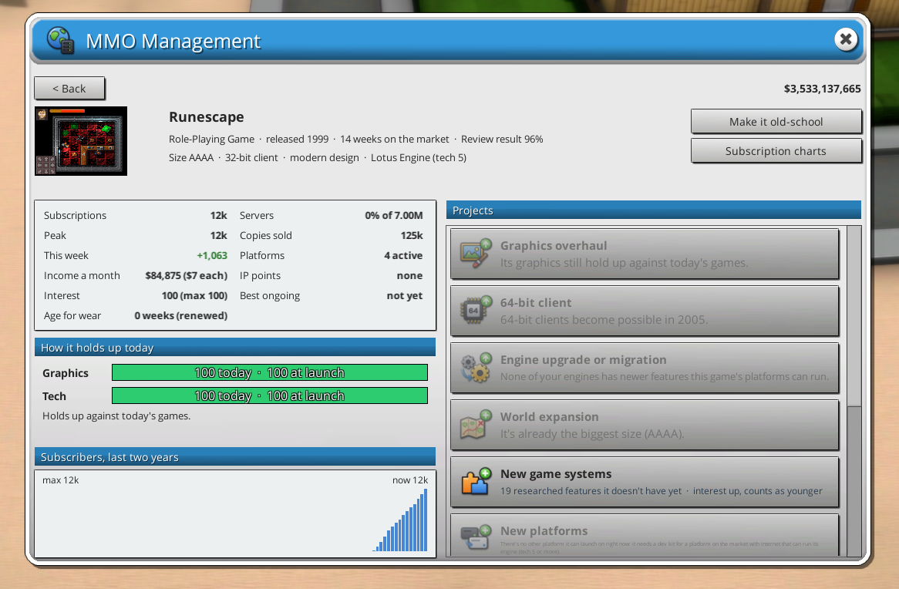
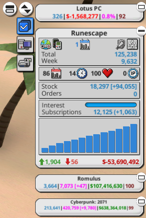
</p>

Keep MMOs alive for decades, like the long-running ones in real life. **MMO Management** (in the development room
menu and on the bottom bar) lists your MMOs, and each gets a dashboard: subscribers, peak, income, interest, age,
servers, how its graphics and tech hold up against today's games, and two years of subscriber history.

Projects you can run on an MMO:

| Project | What it does |
|---|---|
| Graphics overhaul | Brings its graphics back to the standing they had at launch, against today's games. |
| 64-bit client | From 2005; lifts the 2007 graphics ceiling of 32-bit clients and keeps a few more players. |
| Engine upgrade or migration | Newer engine features, or a move to another engine. |
| World expansion | Grows the game a size (B to B+ and so on), with a wait before the next step. |
| Content patch | Fewer players leave for a few weeks. |
| New platforms | Launch on more platforms, past the game's usual limit of four. |
| New game systems | Add gameplay features after release. |
| Age rating change | A wider audience, though some players leave. |
| Expansion pack | The game's MMO addon, now with a lasting boost to new players. |
| Free update | The game's own free update. |

Also:

- **Modern or old-school:** modern MMOs whose graphics and tech fall behind lose players faster. Old-school
  theme-park MMOs don't, and keep a smaller but more loyal audience.
- **Your MMOs keep their IP alive** while they still have players.
- A yearly **Best Ongoing Game** award at the December awards, for MMOs that are a year old or more (rivals'
  included).
- **On the game card:** your MMO's place in the MMO subscription charts (the blue calendar), and the bar chart
  shows subscribers instead of sales.
- The **MMO Subscription Charts** are one click away.

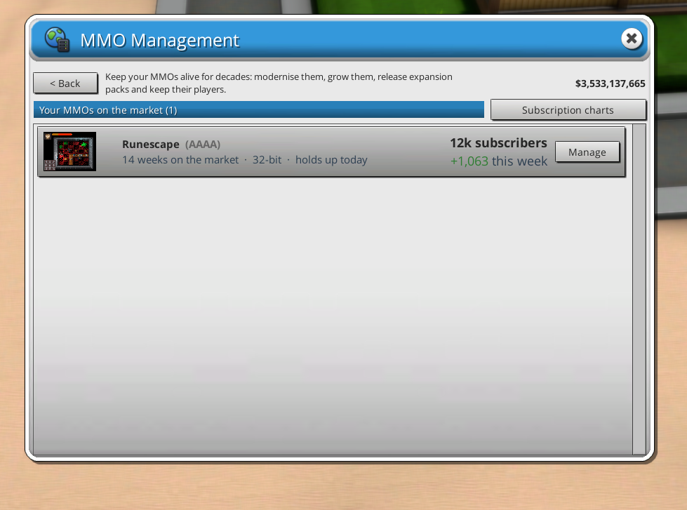

### Your digital store (from 2003)

<p>
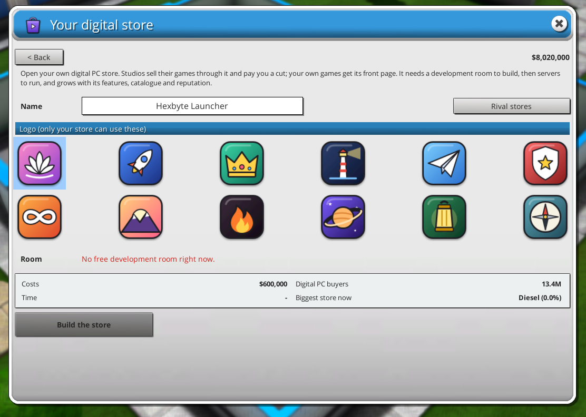
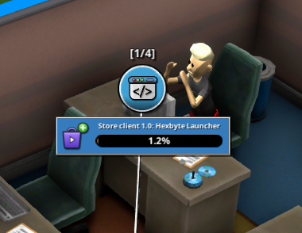
</p>

Build your own digital PC store in a development room, choosing from 12 logos that only your store can use. Other
studios sell through it and pay you a cut, and your own games get its front page. It needs servers, and it grows
with new store features (reviews, friends, auto-updates, regional pricing, achievements, cloud saves), its
catalogue and its reputation.

Rival stores open, change their fees and sometimes close on a timeline that follows real life, from **Diesel** in
2003 to new stores still arriving in the late 2020s. Where your games sell through a rival store, it takes its cut
(10-30%), as in real life. You can switch the cut off.

### Timed exclusives

In the new-game screen, a **Timed exclusive** button lets a multiplatform game launch on one platform first and come
to the others 3 to 24 months later. The platform's maker pays a share of development costs for the deal: the
longer the wait, the bigger the share.

### Working with The Holy Expansion

- Holy's delayed platforms can be changed during development, like retired ones.
- Updates from this addon count as updates for Holy's piracy (they cut pirated copies like a normal update).
- The addon's sales bonuses count toward Holy's sales bonus limit instead of stacking on top of it.
- Holy's seasonal sales (Summer and Winter Sale) start in 2003, when digital stores arrive, instead of 1998. This
  can be switched off.

### Company logos

32 extra logos for your company, each with a matching name, in the logo picker for a new game or when renaming your
company. Rival companies never use them.

---

## Settings

Almost everything can be switched on or off in the addon's window under **Game settings**. All settings are also in
`BepInEx\config\holyunofficialaddon.mgt2.cfg`, which BepInEx creates the first time you start the game. That file
also holds a few extras, such as an optional hotkey for the addon's window, how many outlets review each game, and
the Turbo and Ultra keys.

Settings marked "this game" in the window are saved with your save file. The addon's own options apply to all
saves.

---

## Compatibility and saves

- Made for and played with **The Holy Expansion** and **GameDev Assistant** installed. It should load without
  Holy (Holy's extras then simply do nothing), but that hasn't been tested.
- Made for **single player**. Multiplayer hasn't been tested.
- What the addon adds is saved inside your normal save file, so there's nothing extra to back up or move.
- Saves from older versions of the addon load in newer ones.

---

## Known issues

- **Contracts, game work:** on some studio rows the studio's genre runs into the "About +10 graphics" text.
- **Press reviews** are only written in English. With the game in another language, you get the game's own review
  screen.
- Some newer features haven't had a long play-through yet: the digital store, timed exclusives and the Best Ongoing
  Game award. Please report anything odd.

---

## Building from source

The `Source` folder holds the code (C#, .NET Framework 4.7.2) and the art sources (logos and icons drawn as HTML/SVG
and rendered to PNG). You need the [.NET SDK](https://dotnet.microsoft.com/download) and the game installed with
BepInEx, because the build references the game's own files.

```bash
cd Source
dotnet build -c Release -t:Install -p:GameDir="C:\Program Files (x86)\Steam\steamapps\common\Mad Games Tycoon 2"
```

`-t:Install` copies the built addon straight into the game's `BepInEx\plugins` folder. Leave out `-t:Install` to
only build. Change `GameDir` to wherever your game is.

---

## Credits

- **Mad Games Tycoon 2** by Eggcode Games.
- **The Holy Expansion** by jay (EXTLC), which this addon builds on and adjusts in places with his blessing.
- **BepInEx** and **HarmonyX**, which make mods like this possible.
- Logos, outlet names and store names are original or parodies made for this addon.

See [CHANGELOG.md](CHANGELOG.md) for what changed in each version.
