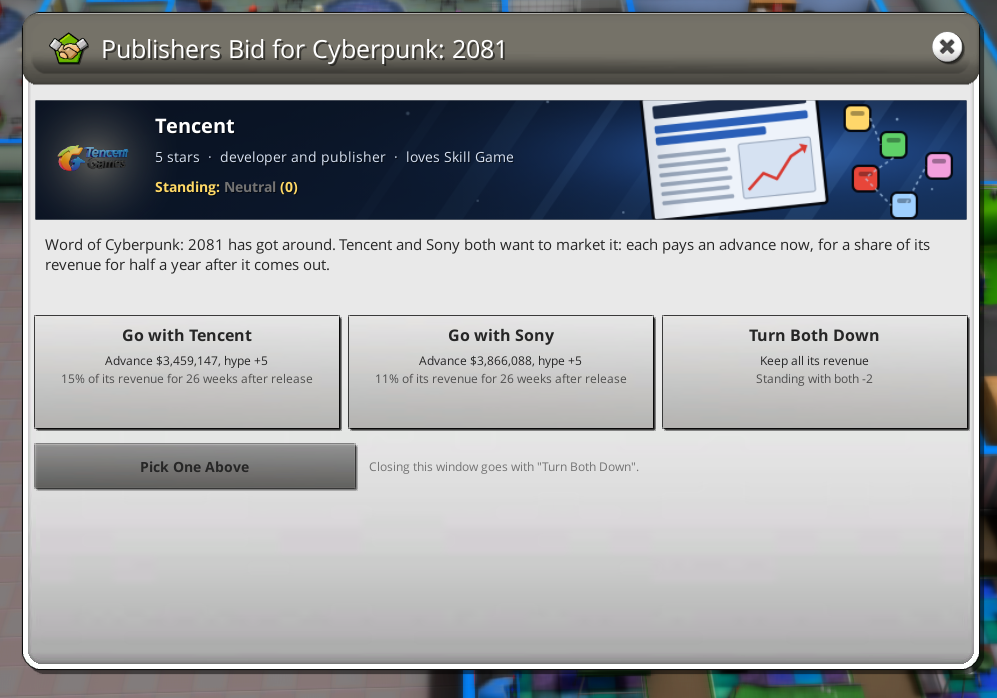
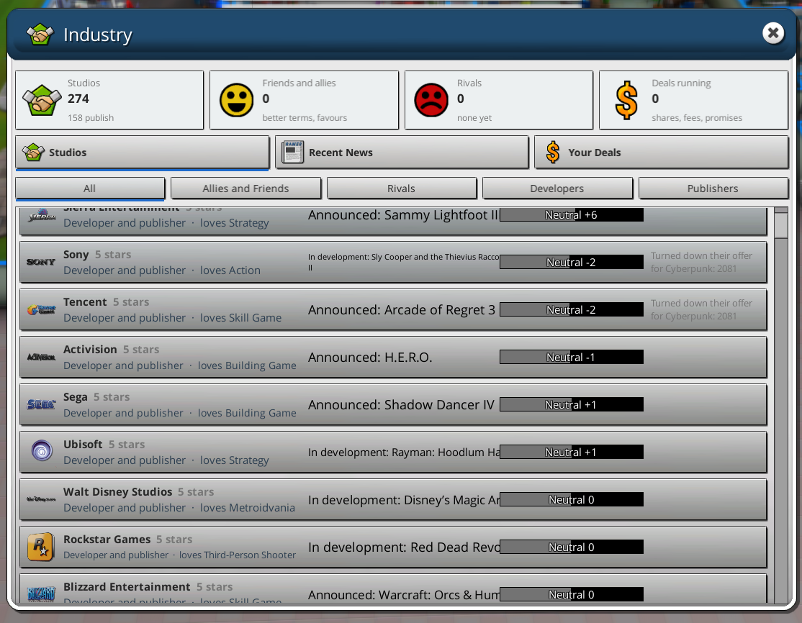
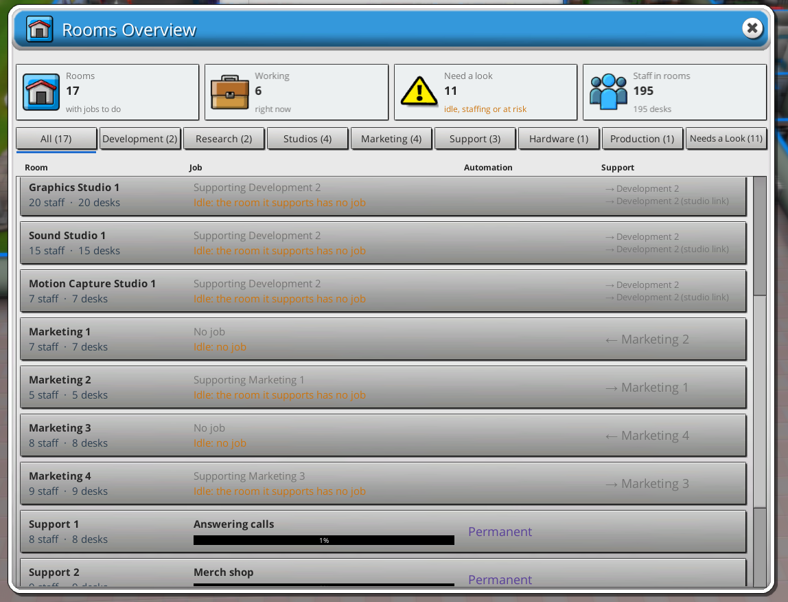
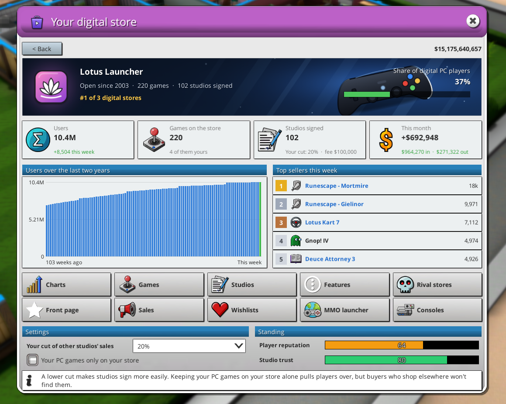
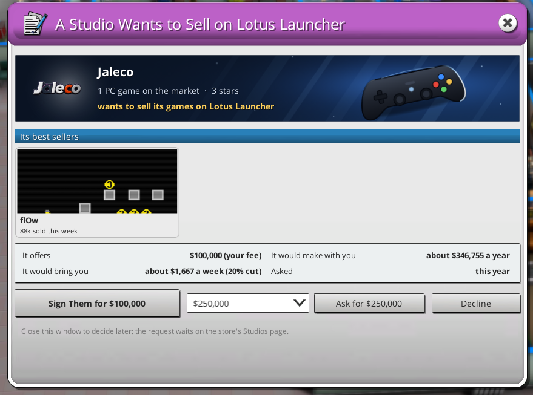
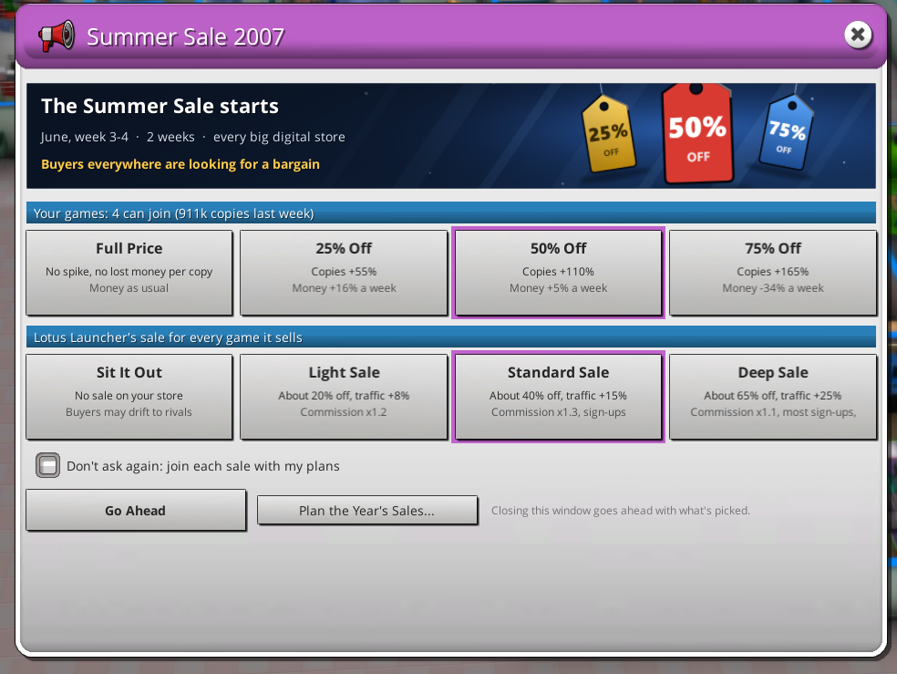
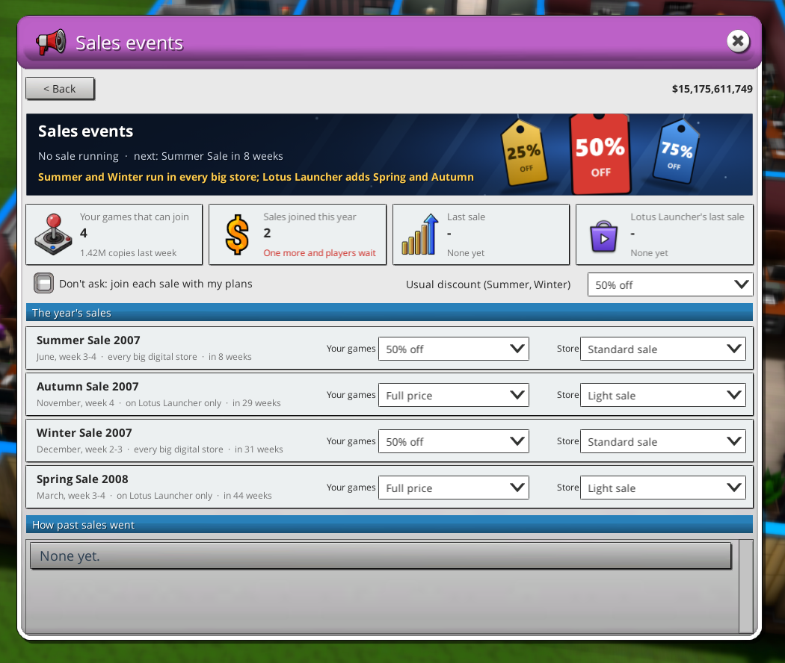
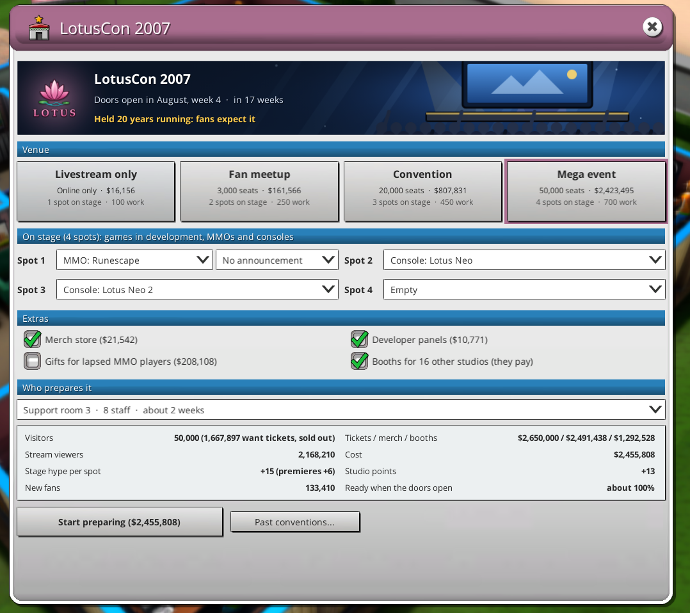
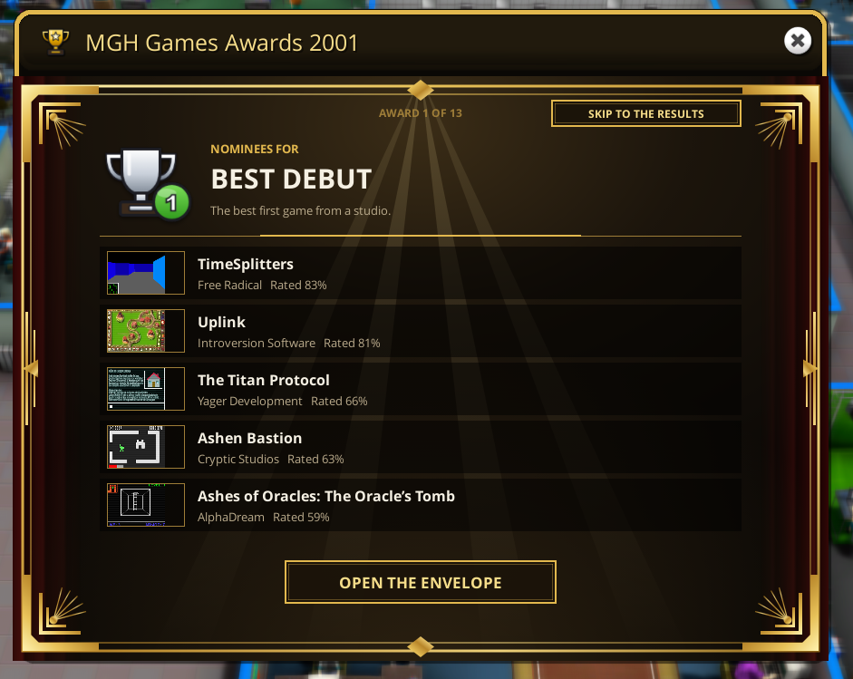
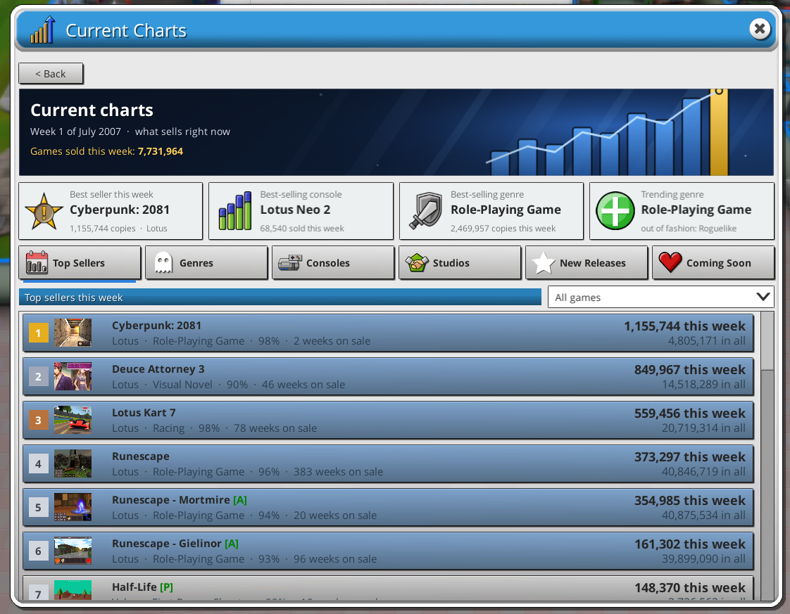

# Holy Unofficial Addon

An unofficial addon for **Mad Games Tycoon 2**, made to sit alongside **The Holy Expansion**. It makes the whole game
livelier, from a 1976 start to the late game:
- **Industry:** events and other studios you deal with.
- **Running your company:** MMOs you can keep alive for decades, your own digital store, sales, a yearly
  convention and an awards ceremony.
- **Tools:** an overview of all your rooms and current charts.
- **Quality of life:** faster speeds and press reviews.

Where it overlaps with The Holy Expansion, the two are merged into one system rather than stacked.

It's a hobby project for friends: not for sale, and not affiliated with Eggcode Games or with The Holy Expansion's
author.

**Version:** 0.20.1 · **Game:** Mad Games Tycoon 2 (Steam, PC) · **Loader:** BepInEx 5


---

## Contents

- [Installing](#installing)
- [Features](#features)
  - [Industry events](#industry-events)
  - [Rooms Overview](#rooms-overview)
  - [MMO Management](#mmo-management)
  - [Your Digital Store](#your-digital-store-from-2003)
  - [Sales Events](#sales-events)
  - [Yearly convention](#yearly-convention)
  - [MGH Games Awards](#mgh-games-awards)
  - [Current Charts](#current-charts)
  - [Contracts](#contracts)
  - [More features](#more-features)
- [Working with The Holy Expansion](#working-with-the-holy-expansion)
- [Settings](#settings)
- [Compatibility and saves](#compatibility-and-saves)
- [Known issues](#known-issues)
- [Building from source](#building-from-source)
- [Credits](#credits)

---

## Installing

**You need:** Mad Games Tycoon 2 with **BepInEx 5** (tested with 5.4.23). If you already play with The Holy
Expansion, you have BepInEx already.

1. On this page, click **Code > Download ZIP** and unzip it.
2. Open the game folder: in Steam, right-click Mad Games Tycoon 2 > **Manage > Browse local files** (the folder with
   `Mad Games Tycoon 2.exe` in it).
3. Copy the **`BepInEx`** folder from the zip's **`Install`** folder into the game folder, and say yes to merging
   folders. The addon ends up in `BepInEx\plugins\HolyUnofficialAddon`.
4. Start the game. The addon's buttons appear on the bottom bar.

**Updating:** do the same again and let the new files replace the old ones. Your settings and saves are kept.

**Removing:** delete `BepInEx\plugins\HolyUnofficialAddon` (and, if you like, its settings file
`BepInEx\config\holyunofficialaddon.mgt2.cfg`). Back up your saves first: loading a save without the addon hasn't
been tested.

---

## Features

### Bottom bar

Six buttons next to the game's own:
- the addon's window;
- **Contracts**;
- **Industry**;
- **Rooms Overview**;
- **MMO Management**;
- **Your Digital Store**.

A button for something you can't use yet is greyed out, and its tooltip says why. Locked menu entries elsewhere work
the same way, like the game's own.

### Industry events

<p>


</p>

The industry around you moves, and things land on your desk.

- **Headlines** in the news every few weeks change the market. They include:
  - a genre craze or fatigue;
  - another studio's hit;
  - a console price cut;
  - studios delaying games, opening and closing.
- **Decisions** pop up at random, more often when the moment fits (you just released a game). They average every
  2-3 months, and you can set them to Calm, Normal or Busy. Each one has 2-4 choices that change your money and
  fans, the market, and your standing with other studios. The first ones:
  - **A Cassette in the Post:** two teenagers send their game. Publish it, hire them or pass.
  - **Print Your Code?:** a magazine wants to print your game's code.
  - **Cabinet Deal:** an arcade chain wants your hit.
  - **A New Machine Wants Games:** a free dev kit if you release on a new platform within a year.
  - **Share a Stand?:** a small studio at the summer trade fair.
  - **A Copy of Your Game:** sue the copycat, outsell it, license it to them, or ignore it.
  - **Publishers Bid** for your game in development: an advance now for a share of its revenue.
  - **A Studio Needs Help** to finish its announced game: fund it for a share of its revenue.
- **Standing with every studio**, from Rival through Neutral and Friendly to Ally, grows out of what happens between
  you. Good turns also improve the game's own relation with them, so you get better publishing terms.
- **The Industry window** has three tabs:
  - **Studios:** each studio's stars, favourite genre, game in development, your standing and your history
    together.
  - **Recent News.**
  - **Your Deals:** revenue shares, fees and promises.

### Rooms Overview



Every room at a glance:
- its job and progress, including Holy's and the addon's jobs;
- what it does by itself (repeat, auto research, autopilot...);
- who supports whom, including Holy's studio links;
- what needs a look:
  - idle, and why (no calls, waiting for money, no bugs left...);
  - staffing problems;
  - jobs at risk, such as a contract that won't make its deadline.

Click a room to go to it: the camera moves there and its menu opens. It opens from the bottom bar, or from a button
in every room's menu.

### MMO Management

<p>


</p>

Keep MMOs alive for decades, like the long-running ones in real life. **MMO Management** is in the development room
menu and on the bottom bar. It lists your MMOs, and each gets a dashboard with:
- subscribers, income and interest;
- its place in the subscription charts;
- bots;
- how its graphics and tech hold up today;
- two years of subscriber history.

| Project | What it does |
|---|---|
| Graphics Overhaul | Brings its graphics back to the standing they had at launch, against today's games. |
| 64-bit Client | From 2005; lifts the 2007 graphics ceiling of 32-bit clients. |
| Engine Upgrade or Migration | Newer engine features, or a move to another engine. |
| World Expansion | Grows the game a size, with a wait before the next step. |
| Content Patch | Keeps players busy for a while (not right after an expansion pack). |
| New Platforms | More platforms, past the game's usual limit of four. Expansion packs come to all of them. |
| New Game Systems | Add gameplay features after release. |
| Age Rating Change | A wider audience, though some players leave. |
| Bot Ban Wave | Clears out bots; income dips, real players stay longer. |
| Stability Patch | Fixes crashes and bugs. Also catches the leftover bug fractions the game couldn't fix. |
| Welcome-Back Campaign | Wins back former players. |
| Free Trial | More new players, but bots love free accounts. |
| Classic Servers | The MMO as it was at launch, in phases, as realms or its own game. |
| Expansion Pack / Free Update | The game's own, now in one place. |

Also:
- **Bots and anti-bot systems:** bots sit among your subscribers and drive real players away. Build your own
  anti-bot system for a genre, or license a rival studio's, and keep it updated.
- **Autopilot:** runs the routine projects for an MMO within rules you set, such as money to keep and rooms to leave
  free.
- **Modern or old-school:** modern MMOs that look dated lose players. Old-school ones keep a smaller, more loyal
  audience.
- **IP:** your MMOs keep their IP alive while they still have players.
- **Game cards:** your MMO's chart place, subscribers and bots on its game card, plus a yearly **Best Ongoing Game**
  award.

### Your Digital Store (from 2003)

<p>


</p>

Build your own digital PC store in a development room, with one of 12 logos only your store can use. Other studios
sell through it and pay you a cut. It needs servers, and it grows with features, its catalogue, its reputation and
studios' trust.

- **Studios:**
  - Studios ask to sell on your store and pay the signing fee you set. Big studios ask in a pop-up.
  - You can sign them, ask for more or decline.

  
- **Front page:**
  - Feature your own games.
  - Or sell the spots to studios by the week.
- **Wishlists and early access** for your games in development.
- **Your MMOs in the store's launcher.**
- **Storefronts on consoles you make.**
- **Charts:** your store's best sellers, and how you rank against the rival stores.
- **Rival stores** open, change their fees and close on a real-life-like timeline from 2003. They take their cut
  of your games sold through them (10-30%); you can switch that off.

The store's windows take your store logo's colour.

### Sales Events

<p>


</p>

One system for seasonal sales. It replaces The Holy Expansion's Seasonal Sales and uses its numbers.

- **Summer and Winter Sales** run in every big store; your store adds a **Spring** and an **Autumn Sale**.
- **A pop-up as each sale starts:**
  - your games' discount (25/50/75%), with what it does to copies and money;
  - your store's own sale for other studios' games.
- **Sale fatigue:** join too many sales in a year and players start waiting for the next one.
- **Plan ahead:** set your plans for the year on the Sales Events page, and let them run without asking if you
  like.

### Yearly convention



Your own convention every August, for all your games. It replaces The Holy Expansion's Fan Convention and the old
MMO FanFest.

- **Planning:** plan it from a Support room, or from the pop-up in early August.
  - **Venue:** livestream, fan meetup, convention or mega event.
  - **On stage:** games in development (premieres), MMOs with an announcement, consoles, and released games to
    showcase or tease a sequel.
  - **Extras:** merch, developer panels, gifts for lapsed players, and booths other studios pay for.
- **Preparing:** a Support room prepares it, and the usual work rules and supporting rooms count. Or hire an event
  agency.
- **The day:** how ready it is when the doors open decides how well it goes. A results screen follows.

### MGH Games Awards



The December awards become a ceremony:
- **12 awards**, with up to five nominees each;
- an envelope for every winner;
- a **Worst Game of the Year**.

The game's own categories keep their prizes. One ceremony never pays out more than sweeping the game's own awards
could.

### Current Charts



**Statistics > Current Charts** shows what sells right now:
- top sellers;
- genres in and out of fashion;
- consoles;
- studios;
- new releases;
- coming soon, with each game's hype and how far along it is.

### Contracts

<p>


</p>

Hire outside studios instead of doing everything in-house:

- **Research:** bundle any number of topics, genres, features, hardware and other research into one contract.
  Studios quote a price and a time.
- **Game work** on a game in development:
  - graphics, sound, gameplay and tech passes;
  - bug fixing;
  - extra hands to finish sooner;
  - QA and studio work.
- Running contracts show as small cards on screen that you can drag where you like.

### More features

- **Your own copy protection:** research it (from 1980) and develop it in a development room, from disk checks to
  always-online DRM. Keep it updated, and license it to other studios.
- **More kinds of updates** in Updates & Addons for your released games:
  - **Port to More Platforms**, of the same kind;
  - **Update the Engine**;
  - **Add Gameplay Features**;
  - **Change the Age Rating**.

  Addons are no longer blocked by features added after release.
- **Timed exclusives:** in the new-game screen, launch a multiplatform game on one platform first. The others follow
  3 to 24 months later, and the platform maker pays a deal.
- **Press reviews:**
  - your games are reviewed by 31 named parody outlets, each with its own logo, scoring scale, reviewers and
    genre-aware text;
  - a strip shows every score;
  - English game language only.
- **The addon's window:**
  - change the new-game settings mid-game;
  - switch any of the addon's features on or off;
  - an employee editor, behind **Enable cheats** in Game settings.

  
- **Faster speeds:** **Turbo** (6x) and **Ultra** (12x) buttons, also on keys **4** and **5**.
- **Building:**
  - looser furniture placement, with a collision leniency slider;
  - furniture overlapping furniture;
  - any object in any room;
  - placed furniture no longer gets picked up by itself after loading a save.
- **Company logos:** 32 extra logos with matching names, only for you.
- **Performance:** a much faster new-game screen in big saves, lighter versions of some of the game's busiest code,
  and a stutter finder that writes a report of what makes the game stutter (off by default).
- **Finances:** the addon's money shows under the right categories on the finance screen (Licenses, Server costs,
  Merchandise...).

<p>


</p>
<p>


</p>

---

## Working with The Holy Expansion

The addon is built on The Holy Expansion 1.8.3. Where both do the same thing, the deeper version wins and the other
is switched off, keeping its good parts:

- **Sales Events** replace Holy's Seasonal Sales; Holy's menu entry opens them.
- **The yearly convention** replaces Holy's Fan Convention. Holy's Support-room button opens its planner, and Holy's
  own room task prepares it.
- **Holy's live-service seasons** started automatically now need a free Marketing room to prepare them, like ones
  you start yourself.
- **Shared sales bonus limit:** the addon's sales bonuses count toward Holy's limit instead of stacking on top.
- **Holy's piracy:** updates from this addon cut pirated copies, like a normal update.
- **Holy's price curve:** costs follow it, so prices keep pace over the years.
- **Supporting rooms:** they count in Holy's time estimates, and show the progress of Holy's jobs.
- **Holy's delayed platforms** can be changed during development.
- **Holy's "Your Anti-Cheat"** is greyed out until anti-cheat software exists.

Each merge can be switched off in Game settings, which brings back Holy's own version.

---

## Settings

Almost everything can be switched on or off in the addon's window under **Game settings**. All settings are also in
`BepInEx\config\holyunofficialaddon.mgt2.cfg`, which BepInEx creates the first time you start the game. That file
also holds a few extras, such as:
- an optional hotkey for the addon's window;
- how many outlets review each game;
- the Turbo and Ultra keys.

Settings marked "this game" in the window are saved with your save file. The addon's own options apply to all
saves.

---

## Compatibility and saves

- Made for and played with **The Holy Expansion 1.8.3** and **GameDev Assistant** installed. It should load without
  Holy (Holy's extras then simply do nothing), but that hasn't been tested.
- Made for **single player**. Multiplayer hasn't been tested.
- What the addon adds is saved inside your normal save file, so there's nothing extra to back up or move. Before a
  save is overwritten, the addon keeps a backup copy, and puts it back if saving fails.
- Saves from older versions of the addon load in newer ones.

---

## Known issues

- **New features need play-testing:** industry events, the Rooms Overview, the yearly convention and Sales Events
  are new in this version. Please report anything odd: numbers that feel off, or events that come too often or too
  rarely.
- **Room menu button:** the Rooms Overview button sits at the end of each room menu's tool row. Please say if it
  looks out of place.
- **Contracts, game work:** on some studio rows the studio's genre runs into the "About +10 graphics" text.
- **Press reviews** are only written in English. With the game in another language, you get the game's own review
  screen.
- **Closing the game** can crash on the way out. That crash is in the game's runtime, and happened before the addon
  too.

---

## Building from source

The `Source` folder holds the code (C#, .NET Framework 4.7.2) and the art sources (logos, icons and banners drawn as
HTML/SVG and rendered to PNG). You need the [.NET SDK](https://dotnet.microsoft.com/download) and the game installed
with BepInEx, because the build references the game's own files.

```bash
cd Source
dotnet build -c Release -t:Install -p:GameDir="C:\Program Files (x86)\Steam\steamapps\common\Mad Games Tycoon 2"
```

`-t:Install` copies the built addon straight into the game's `BepInEx\plugins` folder. Leave out `-t:Install` to
only build. Change `GameDir` to wherever your game is.

---

## Credits

- **Mad Games Tycoon 2** by Eggcode Games.
- **The Holy Expansion** by jay (EXTLC), which this addon builds on and adjusts in places with his blessing.
- **Aerin the Lion's** Unofficial MGT2 Performance Patch, for the idea behind the faster new-game screen.
- **BepInEx** and **HarmonyX**, which make mods like this possible.
- Logos, outlet names, store names and event names are original or parodies made for this addon.

See [CHANGELOG.md](CHANGELOG.md) for what changed in each version.
